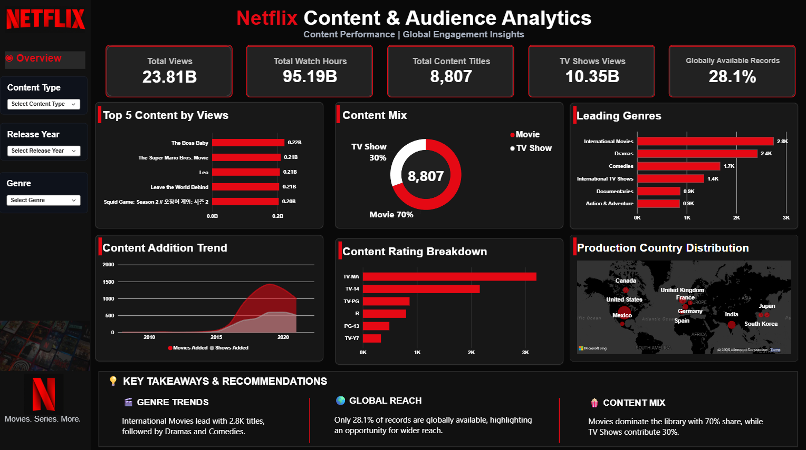

# 🎬 Netflix Content & Audience Analytics

**An End-to-End Data Analytics Project using Python, SQL & Power BI**

---

## 📌 Project Overview

Netflix Content & Audience Analytics is an end-to-end data analytics project focused on exploring and analyzing Netflix's movies and TV shows catalog.

The project involves inspecting raw datasets, performing data cleaning and preprocessing using Python, setting up and validating data using SQL, and developing an interactive Power BI dashboard to present meaningful insights.

The objective is to transform raw data into structured, analysis-ready information and communicate findings through effective data visualization.

## 🎯 Project Objectives

- Explore and understand Netflix movies and TV shows datasets.
- Perform data inspection and identify data quality issues.
- Clean and preprocess datasets using Python.
- Organize and validate structured data using SQL.
- Analyze content distribution and catalog trends.
- Develop an interactive Power BI dashboard.
- Present analytical findings through meaningful visualizations.

## 🛠️ Tools & Technologies

| Technology | Application |
|:---|:---|
| Python | Data Inspection & Cleaning |
| Pandas | Data Manipulation |
| NumPy | Numerical Operations |
| Jupyter Notebook | Python Analysis |
| SQL | Database Setup & Data Validation |
| Power BI | Dashboard Development |
| Excel | Data Review & Supporting Analysis |

## 🔄 Project Workflow

### 1. Data Inspection & Cleaning – Python

- Imported and explored the Netflix datasets using Pandas.
- Inspected dataset structure, columns and data types.
- Identified missing values and data quality issues.
- Performed data cleaning and preprocessing.
- Prepared cleaned datasets for further analysis.
- Exported processed datasets into CSV files.

### 2. Database Setup & Data Validation – SQL

- Created the database structure.
- Set up the required tables.
- Loaded and organized the cleaned datasets.
- Performed data validation checks.
- Verified data consistency and structure.

### 3. Dashboard Development – Power BI

- Used the prepared datasets for dashboard development.
- Created an interactive Netflix analytics dashboard.
- Designed KPI cards and analytical visualizations.
- Explored content distribution and catalog trends.
- Presented key findings through a structured dashboard layout.

## 📊 Dashboard Preview



## 📁 Project Structure

```text
Netflix-Content-Audience-Analytics/
│
├── data/
│   └── processed/
│       ├── movies_cleaned.csv
│       ├── netflix_titles_cleaned.csv
│       └── shows_cleaned.csv
│
├── python/
│   └── 01_Data_Inspection.ipynb
│
├── sql/
│   ├── 01_Database_Setup.sql
│   └── 02_Data_Validation.sql
│
├── power_bi/
│   └── Netflix_Content_Audience_Analytics.pbix
│
└── Dashboard_Screenshots/
    └── Dashboard_Overview.png
```

## 💡 Key Skills Demonstrated

- Data Cleaning & Preprocessing
- Exploratory Data Analysis (EDA)
- Data Manipulation using Pandas & NumPy
- SQL Database Management
- Data Validation
- Data Visualization
- Interactive Dashboard Development
- Analytical Thinking
- Data Storytelling

## 🚀 Project Outcome

Successfully developed an end-to-end data analytics project by integrating Python, SQL, and Power BI into a structured analytical workflow.

The project demonstrates practical skills in transforming raw datasets into clean, structured information and presenting analytical findings through an interactive dashboard.

## 👩‍💻 Author

**Suhani Borikar**

B.Tech – Computer Science & Engineering  
**Technical Skills:** Python | SQL | Excel | Power BI | Pandas | NumPy

LinkedIn: https://www.linkedin.com/in/suhani-borikar/

---

⭐ If you find this project interesting, feel free to explore the repository!
